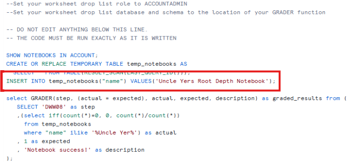
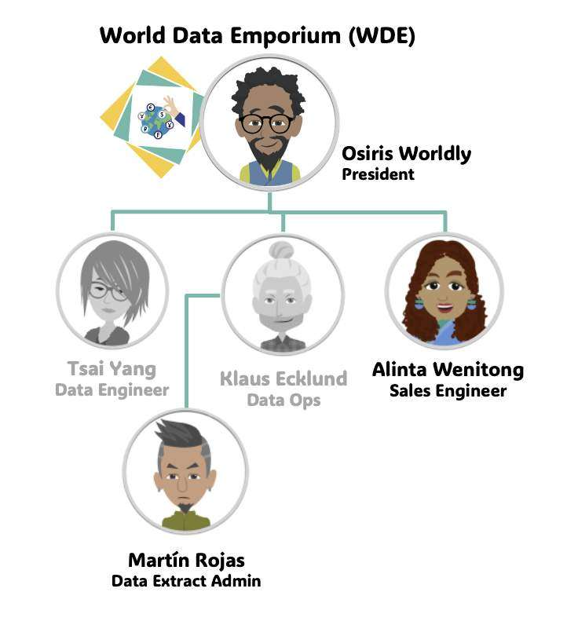
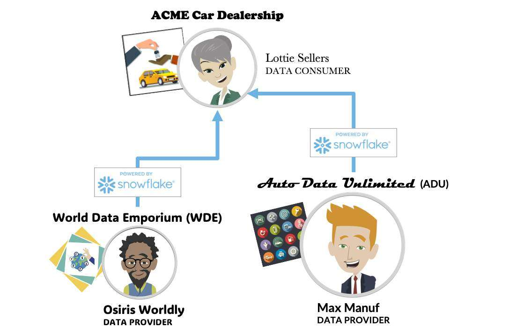
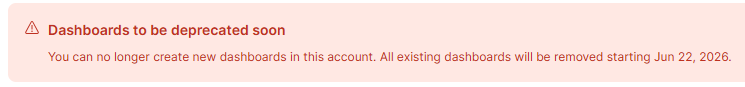

# ❄ Snowflake Training

This is the standard training process that everyone should follow to get started with Snowflake.

> [!CAUTION]
> **Read ALL of these notes BEFORE you start your training**

## Quick Start

### Website addresses
- https://community.snowflake.com
Create a Snowflake Community account here (if you haven't already). Make sure to use your nhs.net email.
- https://training.snowflake.com
Use your Snowflake Community account to login here.
- https://app.snowflake.com
"Snowsight" is the Snowflake web interface. Badge 1 will talk you through this after you've setup a free Snowflake trial account so don't worry about it yet.
- https://ysa.snowflakeuniversity.com
"You're Snow Amazing!" is the Snowflake Workshop Badge Management app. You will need
your UNI ID and Secret UUID to access this. You will also need your Account Identifier and
Account Locator to link your badges. Badge 1 will talk you through this so don't worry about it yet.
- https://achieve.snowflake.com/
Keeps track of the badges you earn. If the badges you completed disappear from your Snowflake Community profile, this site will still confirm that you have completed them.

### 🎯Challenge Labs
All of the Challenge Labs are required and will be checked later so don't skip any and don't proceed until you've completed them ✅successfully! None of the Challenge Labs are optional! DORA is Snowflake's Diagnostic Online Results Assessor. This will connect your trial account to various Snowflake systems that keep track of your Challenge Labs and issue completion badges. Check the Troubleshooting page if you ⛔fail any.

### Start your training
Start with the Free On-Demand Training.

Start with **Badge 1** (it's basic but includes some important fundamental concepts that you may have
missed).

Badge 1 will talk you through how to set up a free Snowflake trial account. Don't attempt to do this
until you are asked. You will use this environment for all the Challenge Labs in the course. Only use
this trial account for your training. Do not use any live accounts. Our live accounts are "Business
Critical" edition. For your trial account make sure to select "Enterprise Edition" (you don't need
"Business Critical" for your free trial as none of the labs will expect that, and it's more expensive so
will burn through your free credits faster with no benefit).
Complete workshop badge 1, then 2, then 5. They must be completed in order. The other badges
aren't required for a Data Engineer role.
| Badge | Code | Workshop Title | Time to Complete | Required |
| --- | --- | --- | --- | --- |
| 1 | DWW | Data Warehouse Workshop | 8 - 12 hours | Yes |
| 2 | CMCW | Collaboration, Marketplace & Cost Estimation Workshop | 8 - 12 hours | Yes |
| 3 | DABW | Data Application Builders Workshop | 8 - 12 hours | No |
| 4 | DLKW | Data Lake Workshop | 8 - 12 hours | No |
| 5 | DNGW | Data Engineering Workshop | 8 - 12 hours | Yes |
| 6 | DSCW | Data Science Workshop | 8 - 12 hours | No |


## Troubleshooting

**Badge 1**

If you're not in the correct database AND schema, then you will probably create objects in the wrong
place! If you have multiple statements and don't highlight all the ones you were asked to run then
you won't run what you were expected to! e.g. DORA scripts.

Lessons 7, 8 and 9 all use the "garden_plants" database which has 3 schemas. These lessons
progress through "veggies", then "flowers", then "fruits". As you progress through the lessons make
sure to use the correct schema before you create any new objects as this won't always be specified
in the Challenge Labs. Don't assume that the schema you're still in from lesson 7 (veggies) is still
correct for lesson 8 (flowers).

**Lesson 50 - 🤖DORA DWW08**
If DORA DWW08 fails, just add this line:
```sql
INSERT INTO temp_notebooks("name") VALUES('Uncle Yers Root Depth Notebook');
```



[Badge 1 - Lesson 8 - DORA DDW08 - Notebook Setup Failing - General - Snowflake](https://snowflake.discourse.group/t/badge-1-lesson-8-dora-ddw08-notebook-setup-failing/19635/2)

**Lesson 55 - 🥼Writing Our Entries to the Database**
🎯Check Your Fruit Details Table & Add More Rows
Before you do this make sure to deploy your Streamlit app to garden_plants.fruits, then run it from
there, then wait for the queries to appear in the Account Usage view. **Latency for this view may be
up to 45 minutes**.
If you don't do this then DORA DWW09 will fail.

[Problems with Snowflake Hands-On Essentials Track — Badge 1: Data Warehousing, DWW09 -
General - Snowflake](https://snowflake.discourse.group/t/problems-with-snowflake-hands-on-essentials-track-badge-1-data-warehousing-dww09/18159)

**Badge 2**
If you're not in the correct account, then you <ins>will</ins> create objects in the wrong place!
e.g. In lessons 6 and 7 you're Lottie and Caden, so make sure you follow the instructions and use the
account you set up for ACME (not your WDE account)!

| World Data Emporium (WDE) | ACME Car Dealership | Auto Data Unlimited (ADU) |
| --- | --- | --- |
| Osiris, Alinta & Martín | Lottie & Caden | Max |
 |||


[Badge2 Lesson4 The UI is different and kept getting error "Cannot set replication schedule for listing
'INTERNATIONAL_CURRENCIES': account not set up for auto-fulfillment" - General - Snowflake](https://snowflake.discourse.group/t/badge2-lesson4-the-ui-is-different-and-kept-getting-error-cannot-set-replication-schedule-for-listing-international-currencies-account-not-set-up-for-auto-fulfillment/19363/2)

"Weather Source LLC: frostbyte" has been superseded by "Pelmorex Weather Source: Frostbyte"
[Unable to find global weather and climate data for BI in badge 2 - General - Snowflake](https://snowflake.discourse.group/t/unable-to-find-global-weather-and-climate-data-for-bi-in-badge-2/19321/8)

Book on to a "Snowflake Fundamentals" (26D14) 4-day course.
- You must complete 3 workshop badges first.
- This is a chargeable ($3,000) Live Virtual Class instructor led course. 
- Snowflake are worldwide so make sure to set the fitlers to EMEA BST/GMT time and English language. The course is offered as consecutive
days or multi-week. Each day is 9am - 5pm.
- https://www.snowflake.com/wp-content/uploads/2022/04/standard_fund_datasheet_20H05.pdf

**Badge 5**
**Lesson 55 - 🥼Writing Our Entries to the Database**
You can't create dashboards anymore because they've already been deprecated!
Run the last select in the lesson then wait 5 mins for the log to update before running the dora script
